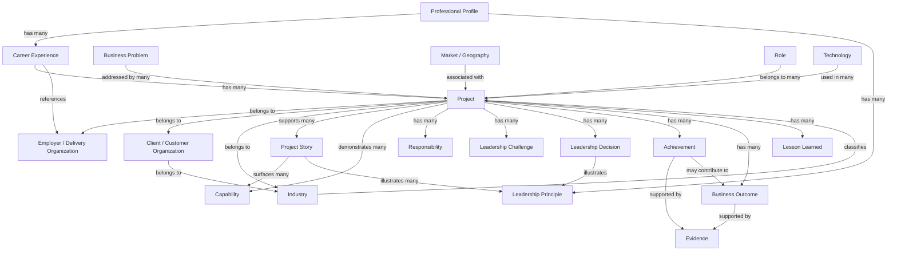

# OOUX Map — Personal Brand Website

**Generated**: 2026-09-29  
**Gate**: B4-gate passed by Product Owner  
**Status**: Approved — Activity 8 output fidelity confirmed by Product Owner on 2026-09-29  
**Figma OOUX page**: [Personal Brand Website — OOUX](https://www.figma.com/design/kq8iw4DPCu9NaJokv9ducT/Personal-Brand-Website?node-id=12-2) (20 uniform object cards; Cover remains empty)

## Authority and Scope

This mapping records the B4-approved Activity 8 object model. A3 remains canonical for domain entities, relationships, properties, rules, evidence/publication decisions, narrative mappings, prominence, and lifecycles. The approved PRD and A10 define the product scope and visitor actions. Properties below are A3-defined fields carried from the approved Activity 7 analysis; they are not new PRD requirements and do not imply that all fields are publicly displayed.

The nine Activity 7 first-class semantic objects remain unchanged. Activity 8 `Core` / `Supporting` is a separate mapping classification, not a change to Activity 7 status or A3 categories. A10 Page/Experience navigation is recorded as experience-level action, never as an A3 domain relationship. Internal Project and Evidence governance is not visitor-facing. Unsupported behavior and object-level state slots remain explicitly unspecified.

**B4 model totals**: 5 Core | 15 Supporting | 0 Boundary | 20 mapped objects | 16 approved experience-level CTA mappings. State accounting: 20 required Core state slots (including explicit “not specified” entries) plus 22 A3 lifecycle labels, kept as distinct state models; the A3 labels are internal/domain states, not UI states.

## Objects

### Professional Profile (core)

**Activity 7 status**: First-class semantic object, unchanged.  
**Definition**: The overall professional identity and positioning of Jairo Enrique Diaz.  
**Properties**: `name`, `tagline`, `vision`, `mission`, `value_proposition`, `leadership_philosophy` [A3].  
**Relationships**: `has many Career Experiences`; `has many Leadership Principles` [A3].  
**CTAs**: Open a relevant Project Story preview from Home; navigate to an approved supporting screen from Home; open Contact from Home/About [3 A10 experience-level actions; not domain relationships].  
**States**: A3 domain state `active` is separate from UI state. A10 state slots: empty—Home incomplete content during local review shows a readiness notice; content must be resolved before public publication; loading—no custom Home loading state; error—document only meaningful asset failures; populated—approved identity/profile content on Home/About. These are Page/Experience states, not Profile-object states. Final wording remains deferred.

### Career Experience (core)

**Activity 7 status**: First-class semantic object, unchanged.  
**Definition**: A period of employment or engagement in Jairo’s career.  
**Properties**: `employer`, `role_title`, `start_date`, `end_date`, `summary`, `key_themes` [A3].  
**Relationships**: `belongs to Professional Profile`; `has many Projects`; `references Employer / Delivery Organization` [A3].  
**CTAs**: From Career Journey, open a related Project or Project Story; continue to Projects; open Contact [3 A10 experience-level actions].  
**States**: A3 domain lifecycle `draft → validated → published` is not a UI state. A10 slots: populated—approved chronological Career Experience context; empty/loading/error—no independent object-level state is specified.

### Project (supporting)

**Activity 7 status**: First-class semantic object, unchanged; internal factual source record.  
**Definition**: The factual record of a professional engagement—what was delivered, for whom, and with what outcomes.  
**Properties**: `title`, `period`, `status`, `geographic_scope`, `publication_class` [A3]. Status and publication classification are internal.  
**Relationships**: Belongs to Employer / Delivery Organization, Client / Customer Organization, and Industry; has Markets / Geographies, Roles, Business Problems, Responsibilities, Leadership Challenges, Leadership Decisions, Achievements, Business Outcomes, Technologies, and Lessons Learned; demonstrates Capabilities; supports Project Stories [A3].  
**CTAs**: No visitor CTA on the underlying Project record. A10 opens Project Stories, not raw Projects.  
**States**: A3 internal lifecycle `draft → normalized → validated`; not visitor-facing.

### Project Story (core)

**Activity 7 status**: First-class semantic object, unchanged.  
**Definition**: The curated public narrative representation of a Project, derived only from a validated Project.  
**Properties**: `title`, `visitor_prominence`, `narrative_role`, `summary`, `leadership_takeaway`, `publication_class`, `evidence_level` [A3]. Prominence, narrative role, and publication-class machinery are not raw UI labels.  
**Relationships**: `derived from one Project`; `surfaces many Capabilities`; `illustrates many Leadership Principles`; `presented by many Pages / Experiences` [A3]. Page / Experience is not a content object in this map.  
**CTAs**: Open from a Project Story summary; return to Projects; follow an approved Related / Next path; open Contact [PRD/A10]. Exact Related / Next targets remain deferred.  
**States**: A3 internal lifecycle `draft → review → approved → published → retired` is not a UI state. A10 slots: empty—Projects’ no-eligible-Story local-review notice and Story Detail’s incomplete-content notice are Page/Experience readiness behavior that must be resolved before public publication; loading—no custom Story Detail loading state; error—meaningful asset/external-reference fallback only; populated—approved, publication-eligible Story.

### Business Problem (supporting)

**Activity 7 status**: First-class semantic object, unchanged.  
**Definition**: The organizational problem a Project addressed, framed in business rather than technology terms.  
**Properties**: `description`, `context`, `severity` [A3].  
**Relationships**: `addressed by many Projects` [A3]. `business_problem_framing` is a Capability property; no separate Business Problem–Capability relationship is added.  
**CTAs**: No object-level CTA. Eligible problem/context may appear in a Story; search/filter is out of scope [PRD/A10].  
**States**: No independent A3 lifecycle or object-level UI state specified.

### Business Outcome (supporting)

**Activity 7 status**: First-class semantic object, unchanged.  
**Definition**: What changed for a client organization or its users.  
**Properties**: `description`, `quantitative_value`, `evidence_ref` [A3]. A quantitative value does not imply a new KPI or numeric target.  
**Relationships**: `belongs to a Project`; `supported by Evidence` [A3]. A10 Story presentation is not a new domain relationship.  
**CTAs**: No standalone outcome CTA; visitors encounter eligible outcomes within a Story [A10].  
**States**: No independent A3 lifecycle or object-level UI state specified.

### Evidence (supporting, internal)

**Activity 7 status**: First-class semantic object, unchanged; content-governance object, primarily internal.  
**Definition**: Supporting material for publishable claims.  
**Properties**: `type`, `value`, `source`, `publication_sensitivity`, `verification_level` [A3].  
**Relationships**: A3 conceptual overlay: Evidence supports Publishable Claims, including claims concerning demonstrated Capabilities. This does not define a direct Evidence→Capability object relationship. A3 separately records Achievements and Business Outcomes as supported by Evidence; no additional direct Evidence-object relationship is inferred.  
**CTAs**: No visitor-facing Evidence action or browser. Optional public reference information is not the internal Evidence object [PRD/A10].  
**States**: A3 internal lifecycle `collected → assessed → verified`; not visitor-facing.

### Capability (core)

**Activity 7 status**: First-class semantic object, unchanged.  
**Definition**: A business-problem-focused capability demonstrated across Projects.  
**Properties**: `name`, `description`, `business_problem_framing` [A3].  
**Relationships**: Demonstrated by Projects; surfaced by Project Stories; presented by Page / Experience [A3].  
**CTAs**: From How I Can Help, open a related Project Story; continue to Projects; open Contact [A10 experience-level actions].  
**States**: A3 internal content lifecycle `draft → validated → published` is not a UI state. A10 slots: populated—approved Capability set, explanations, and related Stories; empty/loading/error—no independent object-level state is specified.

### Leadership Principle (core)

**Activity 7 status**: First-class semantic object, unchanged.  
**Definition**: A core leadership belief demonstrated through Projects.  
**Properties**: `name`, `description` [A3].  
**Relationships**: Illustrated by Project Stories and Leadership Decisions [A3].  
**CTAs**: From Leadership, open a related Project Story; continue to Projects; open Contact [A10 experience-level actions].  
**States**: A3 domain state `active` is not a UI state. A10 slots: populated—approved Principles with supported Project/Decision context and related Stories; empty/loading/error—no independent object-level state is specified.

### Responsibility (supporting)

**Properties**: `description`, `scope` [A3].  
**Relationships**: Belongs to a Project [A3].  
**CTAs**: No separate CTA; presented as approved Story content [A10].  
**States**: No independent A3 lifecycle or object-level UI state specified.

### Leadership Challenge (supporting)

**Properties**: `description`, `impact` [A3].  
**Relationships**: Belongs to a Project [A3].  
**CTAs**: No separate CTA; presented as approved Story context [A10].  
**States**: No independent A3 lifecycle or object-level UI state specified.

### Leadership Decision (supporting)

**Properties**: `description`, `outcome`, `evidence_ref` [A3].  
**Relationships**: Belongs to a Project; illustrates Leadership Principles [A3].  
**CTAs**: No separate CTA; used as approved Story/Leadership context [A10].  
**States**: No independent A3 lifecycle or object-level UI state specified.

### Achievement (supporting)

**Properties**: `description`, `evidence_ref` [A3].  
**Relationships**: Belongs to a Project; supported by Evidence; may contribute to Business Outcomes [A3].  
**CTAs**: No separate CTA; public presentation only within an approved Story [A10].  
**States**: No independent A3 lifecycle or object-level UI state specified.

### Lesson Learned (supporting)

**Properties**: `description`, `context` [A3].  
**Relationships**: Belongs to a Project [A3].  
**CTAs**: No separate CTA; may appear as approved Story/evolution context [A10].  
**States**: No independent A3 lifecycle or object-level UI state specified.

### Employer / Delivery Organization (supporting)

**Properties**: `name`, `sector`, `delivery_model` [A3].  
**Relationships**: Has many Career Experiences and Projects [A3].  
**CTAs**: No standalone CTA; context in approved Career Journey/Story presentation.  
**States**: A3 domain state `active` is reference-data state, not UI state.

### Client / Customer Organization (supporting)

**Properties**: `name_public`, `name_internal`, `industry`, `publication_class` [A3]. Internal identity remains governed.  
**Relationships**: Has many Projects; belongs to Industry [A3].  
**CTAs**: No standalone CTA; identity display follows A3 publication classification.  
**States**: A3 domain state `active` is reference-data state, not UI state.

### Industry (supporting)

**Properties**: `name`, `description` [A3].  
**Relationships**: Contains Clients; classifies Projects [A3].  
**CTAs**: No industry browse/filter CTA [PRD].  
**States**: A3 domain state `active` is reference-data state, not UI state.

### Market / Geography (supporting)

**Properties**: `country_region`, `region` [A3].  
**Relationships**: Associated with Projects [A3].  
**CTAs**: No standalone CTA or geography browse/filter behavior approved.  
**States**: No independent A3 lifecycle specified; no UI state added.

### Role (supporting)

**Properties**: `title`, `level`, `scope` [A3].  
**Relationships**: Belongs to many Projects [A3].  
**CTAs**: No standalone CTA; used as Career Journey/Story context [A10].  
**States**: No independent A3 lifecycle specified; no UI state added.

### Technology (supporting)

**Properties**: `category`, `platforms`, `tools`, `purpose` [A3].  
**Relationships**: Used in many Projects [A3].  
**CTAs**: No technology-catalogue CTA; approved context only [PRD/A10].  
**States**: No independent A3 lifecycle specified; no UI state added.

## Object Relationship Diagram

**Diagram scope**: All edges are A3-defined. The diagram includes the 20 mapped objects and does not include Page / Experience, Audience Segment, or a Publishable Claim object. It contains no Evidence→Capability edge and no navigation/CTA edges. The conceptual Evidence→Publishable Claims overlay remains in the Evidence object description. `Project → belongs to → Employer / Delivery Organization` uses A3's Project-side wording; A3 also explicitly defines `Employer / Delivery Organization → has many → Projects`, the inverse expression of that same relationship. `Achievement → supported by → Evidence` and `Business Outcome → supported by → Evidence` retain the direction explicitly used in A3's supporting-entity model. All other edge directions use A3's stated relationship wording.

## B4 Gate Summary

**5 Core | 15 Supporting | 0 Boundary**  
**20 objects | 16 experience-level CTA mappings**  
**20 Core state slots** (four per Core object, with unsupported slots explicitly “not specified”) **+ 22 A3 lifecycle labels**. These are separate state models; the 22 lifecycle labels are internal/domain states, not UI states.

## Provenance and Preservation

- Activity 7’s nine first-class semantic objects remain unchanged. Four are classified as Supporting in Activity 8 for mapping purposes only; they remain first-class semantic objects from Activity 7.
- The 11 additional Supporting entries are existing A3 nested/context entities; they are not new first-class semantic objects.
- Domain relationships come only from A3. CTAs/navigation come only from PRD/A10 and remain experience-level; they are not converted into domain relationships.
- Project and Evidence governance remains internal/non-visitor-facing. Only publication-eligible content may be presented publicly; optional public references do not expose the internal Evidence object or lifecycle.
- No screens, filters, personalization, new product behaviors, or deferred PRD/A10 decisions have been added.
- A3 property names are carried forward from the approved Activity 7 analysis as canonical domain properties. They are not new PRD requirements and do not imply all fields are publicly displayed.
- A3 lifecycle/governance states are kept separate from A10 Page/Experience states and from the generic OOUX state slots.
- If an actual model gap is exposed during mapping, stop and raise a Product Owner question; do not adjust the B4-approved model by inference.
