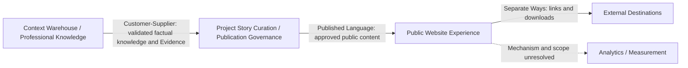

# Architecture Context — Personal Brand Website

This artifact consolidates the approved A9 Steps 1–4 findings. It preserves the canonical A1, A3, A5, and A6 inputs and does not introduce a competing domain model, new lifecycle states, new capability mappings, or new narrative mappings.

## 1. Existing Architecture Baseline

### 1.1 System overview

- **OBS** — Greenfield website runtime: no existing website implementation, deployed runtime, inherited platform, or legacy architecture was found.
- **OBS** — The Context Warehouse is an existing governed source repository, not the website runtime.
- **OBS** — The intended boundary is: Context Warehouse → curated/publication-eligible content → build output → hosting/CDN → visitor browser.
- **INF** — A9 therefore documents a target-context baseline rather than an as-is runtime architecture.

### 1.2 Component and boundary inventory

| Boundary/component | Responsibility | Status |
|---|---|---|
| Context Warehouse | Governed foundation documents, Projects, Evidence, decisions, and future artifacts | **OBS** — existing repository source |
| Content curation/publication preparation | Transform validated source knowledge into approved public content | **OBS** — required boundary; exact mechanism unresolved |
| Build output | Generate deployable website pages and assets | **OBS** — build-time direction; implementation unresolved |
| Hosting/CDN | Serve public pages and assets over the internet | **OBS** — provider and operational model unresolved |
| Visitor browser | Render pages, interactions, links, and downloads | **OBS** — public runtime |
| External destinations | LinkedIn, email, phone, and CV download destinations | **OBS** — no application API contract or SLA required |
| Analytics/measurement | Measure visitor behavior and outcomes | **OBS** — required eventually; mechanism and scope unresolved |

### 1.3 Existing technology, operations, and decisions

- **OBS** — No final frontend framework, content format, CMS, hosting provider, deployment pipeline, analytics tool, or runtime observability approach is selected.
- **OBS** — No existing HLD, system diagram, API specification, runbook, infrastructure document, security document, or website runtime ADR was found.
- **OBS** — No existing-state HLD or legacy-system ADR baseline is required because the website runtime is greenfield.
- **OBS** — The approved project architecture posture is simple, proven, maintainable, proportional, and complexity-justified.

## 2. Landscape Assessment

### 2.1 AQ answers

| ID | Question | Answer | Source | Evidence |
|---|---|---|---|---|
| AQ-001 | Primary business driver | Create an evidence-based professional portfolio that improves relevance assessment and recruiter confidence. | A1 | **OBS** |
| AQ-002 | Timeline to first production release | Product Owner target: complete Explore and Govern work and locally validate the MVP by mid-October 2026. This is not a committed public production-release date. | Approved A9 Step 2 landscape | **OBS** |
| AQ-004 | Expected scale and data volume | No numeric traffic or data-volume target is required for MVP; high-volume scalability is not an identified concern. | Approved A9 Step 2 landscape | **OBS** |
| AQ-005 | Seasonal or event-driven load | No seasonal or event-driven load requirement is identified. | Approved A9 Step 2 landscape | **OBS** |
| AQ-006 | Data ownership and residency | The Warehouse governs source context and the website consumes curated content. No explicit content data-residency requirement is identified; revisit only if analytics/privacy decisions create one. | A1, A5, approved A9 Step 2 landscape | **OBS** |
| AQ-007 | Consistency model | Content consistency follows the governed publication/build cycle. No real-time or distributed consistency requirement exists. | A5, approved A9 Step 2 landscape | **OBS** |
| AQ-008 | External systems and contracts | LinkedIn, email, phone, and CV destinations require no application API contract or SLA. Hosting and analytics are separate unresolved concerns. | A1, A5, approved A9 Step 2 landscape | **OBS** |
| AQ-009 | Unstable integrations | No unstable application integration is identified. Ordinary external-link failure remains a proportional operational concern. | Approved A9 Step 2 landscape | **OBS** |
| AQ-010 | Non-negotiable technology constraints | Frontend-only is the approved intended MVP boundary. No framework, provider, or database is mandated; stack, hosting, and deployment selection remain downstream architecture/solutioning decisions informed by A9. | A1, A5, approved A9 Step 2 landscape | **OBS** |
| AQ-011 | Compliance and audit | No sector-specific compliance framework or formal runtime audit requirement is identified. Publication sensitivity, privacy basics, and accessibility remain applicable. | A1, A5, approved A9 Step 2 landscape | **OBS** |
| AQ-012 | Risk tolerance | Project-level posture is simple, proven, maintainable, proportional, and complexity-justified by concrete requirements or risks. | A5, approved A9 Step 2 landscape | **OBS** |

### 2.2 IT environment and stakeholders

- **OBS** — Jairo Enrique Diaz is Product Owner, content owner, sponsor, and final decision authority.
- **OBS** — Devin acts as architect/lead engineer and provides recommendations, feasibility assessment, and challenge of assumptions.
- **OBS** — Recruiters, hiring managers, and delivery/technology leaders are external audience contexts, not system operators.
- **OBS** — Dava.Flow provides the current discovery governance, approval gates, canonical-artifact controls, and traceability process.
- **OBS** — No implementation delivery pipeline or runtime operating model currently exists.

### 2.3 Maturity assessment

| Dimension | Level | Evidence |
|---|---|---|
| Architecture governance | Artifact-governed; runtime governance not established | **OBS** — approved artifacts and review gates exist; no runtime exists |
| Technology adoption | Unknown | **OBS** — no technology stack selected |
| Operational readiness | Not established | **OBS** — no deployment, monitoring, incident-response, or rollback process exists |
| Delivery practices | Discovery-governed; implementation maturity not evidenced | **OBS** |
| Cloud/hosting maturity | Unknown | **OBS** — hosting not selected |

## 3. Architecture Drivers

### 3.1 Ranked driver matrix

| Rank | Driver | Type | Impact | Uncertainty | Tension with | Source / evidence |
|---:|---|---|---|---|---|---|
| 1 | Publication eligibility and restricted-evidence separation | Hard constraint / functional | High | High | Simplicity and delivery speed | A3, A5 — **OBS** |
| 2 | Context Warehouse/runtime boundary | Hard constraint / functional | High | Low–Medium | Freshness and operational simplicity | A1, A5 — **OBS** |
| 3 | Evidence truthfulness and traceability | Hard constraint / functional | High | Medium | Content speed and narrative richness | A1, A3 — **OBS** |
| 4 | Project/Project Story separation | Hard constraint / functional | High | Low | File-model simplicity | A3 — **OBS** |
| 5 | MVP complexity boundary | Hard constraint / scope | High | Medium | Future functionality and flexibility | A1, A5 — **OBS** |
| 6 | Simple, maintainable delivery compatible with the mid-October Product Owner target | Delivery driver | High | Medium | Governance depth and infrastructure capability | Approved A9 Step 2 landscape — **OBS** |
| 7 | File-based governed-content feasibility | Soft preference / functional | High | High | Rich relational modeling and publication controls | A5 — **OBS** |
| 8 | Static/build-time delivery feasibility | Soft preference / functional | Medium–High | High | Freshness and approval workflow flexibility | A1, A5 — **OBS** |
| 9 | Progressive disclosure with accessible scanning | MUST functional / quality | Medium–High | Medium | Content depth and initial cognitive load | A1, A6 — **OBS** |
| 10 | Hosting reliability, HTTPS, preview, and rollback | Proportional quality/operational driver | Medium | Medium | Low cost and minimal infrastructure | A5 — **OBS** |

### 3.2 Functional drivers

| ID | Driver | Priority | Complexity | Uncertainty | Dependencies |
|---|---|---:|---:|---:|---|
| F1 | Deliver evidence-based Project Stories that communicate relevance, leadership, and business value. | MUST | Medium | Medium | Validated Projects, Evidence, curation |
| F2 | Enforce publication eligibility before content reaches deployment. | MUST | High | High | Approval state, publication class, build/deployment boundary |
| F3 | Keep factual Project records separate from curated public Project Story records. | MUST | Medium | Low | A3 domain model |
| F4 | Preserve Evidence traceability, attribution, verification, and sensitivity. | MUST | High | Medium | Evidence lifecycle and publication control |
| F5 | Support the approved MVP pages and visitor journey. | MUST | Medium | Low | Public Website Experience |
| F6 | Provide progressive disclosure from concise summaries to deeper evidence. | MUST | Medium | Medium | A10 experience design; public content structure |
| F7 | Derive contextual navigation from approved relationships without backend functionality. | SHOULD | Medium | High | Structured relationships; build-time generation feasibility |

### 3.3 Quality attributes

Numeric targets are not invented where none were approved.

| Attribute | Proportional target | Evidence |
|---|---|---|
| Truthfulness and traceability | Every material public claim is traceable, attributable, and defensible. | A1, A3 — **OBS** |
| Publication safety | Internal or restricted Evidence must not become deployable public content. | A3, A5 — **OBS** |
| Maintainability | Keep the solution small, understandable, and updateable without unnecessary infrastructure. | A5 — **OBS** |
| Performance | Provide reasonable page and asset performance on representative desktop/mobile conditions; no numeric target approved. | A5 — **OBS** |
| Accessibility and usability | Preserve accessible, responsive, easy-to-scan behavior; no specific conformance level approved. | A5 — **OBS** |
| Delivery reliability | Provide proportionate HTTPS, review/preview, reliable delivery, and rollback capability; no uptime SLA defined. | A5 — **OBS** |
| Measurement readiness | Allow later minimal measurement and privacy decisions without unnecessary redesign. | A5 — **OBS** |
| Scalability | No high-volume scalability target or investment is required for MVP. | Approved A9 Step 2 landscape — **OBS** |

### 3.4 PoC or validation candidates

- **ASM** — Markdown/file-based content can represent the approved A3 model without material drawbacks.
- **ASM** — A representative Project/Project Story sample can be structured and reviewed safely using the preferred file-based direction.
- **ASM** — Contextual navigation can be generated from approved relationships without backend functionality.
- **ASM** — Hosting/deployment can meet proportional HTTPS, preview, rollback, and reliability needs within the delivery target.

## 4. Domain Model Sketch

This is a light architecture interpretation of the canonical A3 domain model. A3 remains authoritative for entities, relationships, lifecycles, business rules, capability mappings, narrative mappings, and glossary terms.

### 4.1 Bounded contexts

| Bounded context | Responsibility | Data ownership | Evidence |
|---|---|---|---|
| Context Warehouse / Professional Knowledge | Maintain governed professional knowledge and factual evidence. | `Career Experience`, validated `Project`, `Evidence`, source facts, references, and sensitivity metadata. | A3, A1 — **OBS** |
| Project Story Curation / Publication Governance | Transform validated Projects into approved public narratives and control eligibility. | `Project Story`, narrative role, prominence, publication class, approval state, and public-content eligibility. | A3, A5 — **OBS** |
| Public Website Experience | Present approved content through the visitor journey and approved pages. | `Page / Experience`, navigation, presentation structure, and consumption of approved public entities. | A1, A3 — **OBS** |

### 4.2 Context map

- **INF** — The Warehouse acts as upstream supplier to curation and publication governance.
- **INF** — Approved Project Stories and related public entities form the build-consumable published language for the website.
- **OBS** — External destinations require no application API contract or SLA.

### 4.3 Aggregates and glossary

- **OBS** — Aggregate design and state-machine modeling are skipped for ERC.
- **OBS** — No new glossary terms are introduced. Existing A3 terminology remains authoritative.

### 4.4 Preserved architecture-model gaps

1. **Publication-control stage — ASM:** may operate at content preparation, pre-build, build, deployment, or a combination.
2. **Build boundary ownership — ASM:** the division between curated approved content and generated website content is not yet defined.
3. **File-based representation — ASM:** the preferred file-based direction has not yet been proven sufficient for the A3 model and governance needs.
4. **Analytics boundary — ASM:** measurement is required eventually, but its mechanism and data boundary remain unresolved.

## 5. Constraints Register

| # | Constraint | Type | Classification | Source / evidence |
|---:|---|---|---|---|
| 1 | Context Warehouse is not the website runtime content source. | Platform/boundary | Hard | A1 — **OBS** |
| 2 | Only publication-eligible content may reach public deployment. | Governance | Hard | A3, A5 — **OBS** |
| 3 | Internal/restricted Evidence must remain separate from deployable public content. | Security/privacy | Hard | A3, A5 — **OBS** |
| 4 | Public claims require truthful, traceable, attributable, defensible Evidence. | Content integrity | Hard | A1, A3 — **OBS** |
| 5 | Project Stories derive from validated Projects. | Domain | Hard | A3 — **OBS** |
| 6 | MVP complexity boundary excludes backend-dependent functionality unless an approved requirement or identified risk demonstrates insufficiency. | Technology/scope | Hard | A1, A5 — **OBS** |
| 7 | Progressive disclosure is required; its implementation is determined in A10. | Product/UX | Hard | A1, A6 — **OBS** |
| 8 | Explore/Govern plus locally validated MVP implementation are targeted for mid-October 2026; public production date is not committed. | Delivery | Soft delivery target | Approved A9 Step 2 landscape — **OBS** |
| 9 | Prefer Markdown/file-based governed content. | Technology | Soft | A5 — **OBS** |
| 10 | Prefer static/build-time delivery. | Technology | Soft | A1, A5 — **OBS** |
| 11 | Prefer low-cost, reliable, simple, maintainable hosting. | Procurement/operations | Soft | A1, A5 — **OBS** |
| 12 | Added complexity requires a concrete approved requirement or identified risk. | Architecture governance | Soft preference / decision guardrail | A5 — **OBS** |
| 13 | No numeric high-volume scalability target is required for MVP. | Scale | Scope boundary | Approved A9 Step 2 landscape — **OBS** |

## 6. Open Questions

| # | Question | Owner | Priority | Impact if unresolved | Source step |
|---:|---|---|---:|---|---|
| 1 | Can the preferred Markdown/file-based approach represent and govern the approved A3 model without material drawbacks? | Architect / Lead Engineer recommends; Jairo approves | High | May require a more complex content or governance mechanism. | A5 / A9 Step 3–4 |
| 2 | At which content preparation, pre-build, build, or deployment stage is publication eligibility enforced? | Architect / Lead Engineer recommends; Jairo approves | High | Risk of restricted or unapproved content reaching deployment. | A9 Steps 1, 3, 4 |
| 3 | Who owns the boundary between curated approved content and generated website content? | Architect / Lead Engineer recommends; Jairo approves | High | Ambiguous ownership and weak change control. | A9 Step 4 |
| 4 | Can a representative Project/Project Story sample be structured and reviewed safely using the preferred file-based direction? | Architect / Lead Engineer recommends; Jairo approves | High | File-based feasibility remains unsubstantiated. | A5 / A9 Step 3 |
| 5 | Can contextual navigation be generated from approved relationships without backend functionality? | Architect / Lead Engineer recommends; Jairo approves | Medium | May affect navigation scope or require additional build capability. | A5 / A9 Step 3–4 |
| 6 | Which candidate stack, hosting, preview, rollback, and deployment approach meets proportional MVP needs? | Architect / Lead Engineer recommends; Jairo approves | High | Public release timing and operational readiness remain uncertain. | A5 / A9 Step 2–3 |
| 7 | What public production-release date, if any, follows the mid-October local-validation target? | Jairo | Medium | Deployment planning remains incomplete. | A9 Step 2 |
| 8 | What minimum analytics and privacy approach will be selected later? | Jairo | Medium | Measurement may require later boundary changes. | A5 / A9 Step 2 |
| 9 | Could later analytics/privacy decisions create an explicit data-residency requirement? | Jairo | Low/conditional | AQ-006 may require revisiting. | A9 Step 2 |
| 10 | What accessibility conformance level, if any, will be adopted beyond the current accessible/responsive requirement? | Jairo | Medium | Validation criteria remain qualitative. | A5 / A9 Step 3 |

## 7. Solutioning Readiness Summary

### Available for solutioning

- [x] Greenfield baseline and source-document inventory.
- [x] Landscape assessment and AQ classifications.
- [x] Ranked architecture drivers and quality attributes.
- [x] Hard and soft constraints register.
- [x] Light bounded-context and context-map view consolidated with A3.
- [x] Open questions and architecture risks with owners and priorities.

### Highest-priority solutioning inputs

1. Publication eligibility and restricted-evidence separation.
2. Context Warehouse/runtime and build-boundary ownership.
3. Feasibility of governed file-based content for the A3 model.
4. Frontend-only MVP complexity boundary and proportional hosting/deployment.
5. Evidence truthfulness, progressive disclosure, accessibility, and maintainability.

### Risks carried forward

- **ASM** — File-based content may not safely represent all required relationships and governance metadata.
- **ASM** — Publication-control stage and build-boundary ownership remain undefined.
- **ASM** — Hosting/deployment may not meet the delivery target without added complexity.
- **ASM** — Analytics/privacy decisions may later affect the build/runtime boundary.

## 8. Final Cross-Reference Validation

- [x] All approved Step 1 ingestion findings are represented: greenfield baseline, Context Warehouse/runtime boundary, source inventory, absence of inherited runtime architecture, and no existing ADR/HLD baseline.
- [x] All approved Step 2 landscape findings are represented: AQ classifications, mid-October local-validation target, non-requirement treatment for scale/load/residency/integration/compliance, project-level risk posture, and maturity assessment.
- [x] All approved Step 3 driver findings are represented: functional drivers, quality attributes, hard constraints, soft preferences, risks, tensions, unresolved assumptions, and corrected F6/frontend-only/delivery-target treatment.
- [x] All approved Step 4 findings are represented: three-context architecture view, Mermaid context map, A3 canonical-model reference, no new glossary terms, and the four preserved architecture-model gaps.
- [x] Every MUST functional driver maps to at least one bounded context.
- [x] Every hard constraint is reflected in a driver, quality attribute, or both.
- [x] No `ASM` item is presented as an established fact.
- [x] No unsupported numeric NFR target has been introduced.
- [x] No new domain entity, lifecycle state, capability mapping, narrative mapping, or glossary term has been introduced.
- [x] A3 remains the canonical source for domain detail.

**Internal validation result:** PASSED — Product Owner approved. A9 Architecture Context is COMPLETE / VALIDATED.
