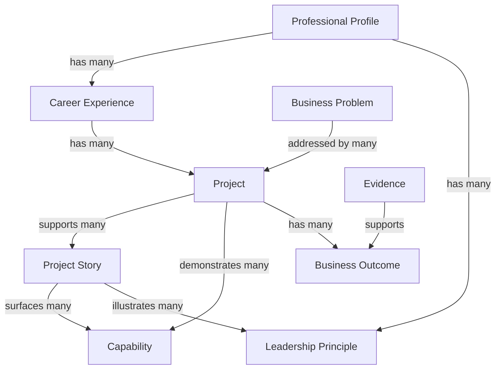

# OOUX Analysis: Personal Brand Website

**Project**: `personal-brand-website`  
**Created**: 2026-09-29  
**Last Updated**: 2026-09-29  
**Status**: Approved

---

## Authority, Inputs, and Boundaries

This Activity 7 analysis consumes the [approved PRD](personal-brand-website-prd.md) and the locked [Step 4 derived domain input](personal-brand-website-domain.md), consulting [A3 Domain Analysis](domain-analysis.md) as the canonical authority for every domain fact, entity, relationship, mapping, rule, evidence/publication decision, narrative role/theme, prominence decision, and lifecycle. The approved [A10 wireframes and flows](wireframes-personal-brand-website.md) govern the existing experience structure and visitor actions.

The nine first-class semantic OOUX candidates below were approved at the Activity 7 Step 2 gate. First-class status is a modeling classification only; it does not itself authorize a screen, navigation item, browse/filter taxonomy, public representation, or visitor CTA. A3 relationships and PRD/A10 experience actions are kept separate throughout this artifact.

The approved eight-screen A10 inventory, responsibilities, flows, progressive-disclosure principles, accessibility requirements, and non-linear Recruiter Journey are consumed unchanged. Internal Project and Evidence governance is not visitor-facing. The three Ideation concepts remain distinct product/design context at their approved levels: Credible Story Layers at the individual Project Story level; Evidence Paths, Not Funnel across approved relationships and visitor-selected exploration; and Capability and Growth Threads at the collective portfolio-evidence level. Preserve the canonical Tigo → Avianca → DFA professional-evolution arc and its A3 qualifications. This is a narrative sequence, not a new Capability, object, or mandatory visitor path. The concepts introduce no domain objects or relationships.

No A3, A10, PRD, or derived-domain content is changed here. All deferred PRD/A10 decisions remain unresolved.

---

## 1. Object Inventory

`[FACT]` indicates that A3 defines the entity. The nine first-class OOUX candidates and their classification were approved by the Product Owner for this analysis. The evidence tag does not assert that all attributes are public or visitor-visible.

| # | Object | Definition | Type | Evidence |
|---:|---|---|---|---|
| 1 | **Professional Profile** | The overall professional identity and positioning of Jairo Enrique Diaz. | Concept | [FACT] Canonical A3 entity; approved first-class candidate. |
| 2 | **Career Experience** | A period of employment or engagement in Jairo’s career. | Thing | [FACT] Canonical A3 entity; approved first-class candidate. |
| 3 | **Project** | The factual record of a professional engagement—what was delivered, for whom, and with what outcomes. | Thing | [FACT] Canonical A3 entity; approved first-class candidate. It remains distinct from Project Story and is an internal source record. |
| 4 | **Project Story** | The curated public narrative representation of a Project, derived only from a validated Project. | Thing | [FACT] Canonical A3 entity; approved first-class candidate. |
| 5 | **Business Problem** | The organizational problem a Project addressed, framed in business rather than technology terms. | Concept | [FACT] Canonical A3 entity; approved first-class semantic candidate. |
| 6 | **Business Outcome** | What changed for a client organization or its users. | Concept | [FACT] Canonical A3 entity; approved first-class semantic candidate. |
| 7 | **Evidence** | Supporting material for publishable claims. | Thing | [FACT] Canonical A3 entity; approved first-class content-governance candidate, primarily internal. |
| 8 | **Capability** | A business-problem-focused capability demonstrated across Projects. | Concept | [FACT] Canonical A3 entity and taxonomy; approved first-class candidate. |
| 9 | **Leadership Principle** | A core leadership belief demonstrated through Projects. | Concept | [FACT] Canonical A3 entity; approved first-class candidate. |

**Total objects**: 9 (target: 5–12). The count is within the OOUX guidance; no additional objects were added to reach a target.

---

## 2. ORCA Table

Relationship entries are sourced from A3. CTA/action entries are sourced from the approved PRD/A10, or explicitly state that no object-level action is approved. Attribute lists use canonical A3 fields only. Experience-level navigation is not represented as an A3 domain relationship.

| Object | Relationships | Calls to Action | Attributes |
|---|---|---|---|
| **Professional Profile** | `has many Career Experiences`; `has many Leadership Principles` **[FACT — A3 §2]** | No object-level CTA is approved. Home/About navigation to Project Stories, supporting screens, and Contact is an A10 Page/Experience action, not a Profile relationship or object-specific action **[FACT — A10]**. | `name`, `tagline`, `vision`, `mission`, `value_proposition`, `leadership_philosophy` **[FACT — A3 §2]**. Final profile summary and wording remain unresolved. |
| **Career Experience** | `belongs to Professional Profile`; `has many Projects`; `references Employer / Delivery Organization` **[FACT — A3 §2]** | From Career Journey, continue to a related Project or Project Story, Projects, or Contact **[FACT — A10]**. These are approved experience paths, not new domain relationships or authoring actions. | `employer`, `role_title`, `start_date`, `end_date`, `summary`, `key_themes` **[FACT — A3 §2]**. Public claims about employer, title, dates, progression, and themes require validation under A3. |
| **Project** | `belongs to Employer / Delivery Organization`, `Client / Customer Organization`, and `Industry`; `has many Markets / Geographies`, `Roles`, `Business Problems`, `Responsibilities`, `Leadership Challenges`, `Leadership Decisions`, `Achievements`, `Business Outcomes`, `Technologies`, and `Lessons Learned`; `demonstrates many Capabilities`; `supports many Project Stories` **[FACT — A3 §2]**. | No visitor CTA is approved for the underlying Project record. A10 actions open or navigate among Project Stories, not the internal Project record. No create/edit/publish/manage action is introduced. | `title`, `period`, `status`, `geographic_scope`, `publication_class` **[FACT — A3 §2]**. Project status and publication classification are internal/governance data; only publication-eligible content may be presented publicly. |
| **Project Story** | `derived from one Project`; `surfaces many Capabilities`; `illustrates many Leadership Principles`; `presented by many Pages / Experiences` **[FACT — A3 §2]**. The Page / Experience relationship remains canonical but is not an OOUX content-object edge. | Read the Story; open a Story from its Projects summary; return to Projects; explore an approved Related / Next path; open Contact; use primary navigation **[FACT — PRD/A10]**. Exact Related / Next targets remain unresolved. | `title`, `visitor_prominence`, `narrative_role`, `summary`, `leadership_takeaway`, `publication_class`, `evidence_level` **[FACT — A3 §2]**. A3’s `project_id` reference is represented by the Project relationship. Prominence, narrative role, and publication-class machinery are not exposed as raw UI labels. A10’s optional public reference information is not the internal Evidence object. |
| **Business Problem** | `addressed by many Projects` **[FACT — A3 supporting entities]**. A3 defines `business_problem_framing` as a Capability attribute; no separate Business Problem–Capability relationship is added. | No standalone action or browse/filter CTA is approved. Search and filtering are explicitly out of scope **[FACT — PRD]**. Eligible problem/context information may be presented within a Story where A10 allows it **[FACT — A10]**. | `description`, `context`, `severity` **[FACT — A3 supporting entities]**. Only canonical A3 fields are included. |
| **Business Outcome** | `belongs to a Project`; `supported by Evidence` **[FACT — A3 supporting entities]**. A10 presents approved outcomes within Project Story Detail; this is experience presentation, not a new domain relationship. | No outcome-specific CTA or standalone outcome navigation is approved. Visitors encounter eligible outcome content while evaluating a Project Story **[FACT — A10]**. | `description`, `quantitative_value`, `evidence_ref` **[FACT — A3 supporting entities]**. `quantitative_value` does not imply a new KPI or numeric target. |
| **Evidence** | A3’s conceptual overlay is `Evidence` → supports → publishable claims, including claims about Achievements, Business Outcomes, Leadership Decisions, Responsibilities, and Capabilities **[FACT — A3]**. For Capabilities, this means a publishable claim about a demonstrated Capability; it does not define a direct `Evidence` → `Capability` object relationship. A3 separately defines `Project` → demonstrates → `Capability`. | No visitor-facing Evidence action, browser, lifecycle, or governance UI is approved. A10 permits optional public evidence/reference information only where publication-eligible and materially useful; that is not an action on the internal Evidence object **[FACT — PRD/A10]**. | `type`, `value`, `source`, `publication_sensitivity`, `verification_level` **[FACT — A3 supporting entities]**. Internal/restricted fields and lifecycle remain non-visitor-facing. |
| **Capability** | `demonstrated by many Projects`; `surfaced by many Project Stories`; `presented by many Pages / Experiences` **[FACT — A3 §2]**. | Open a related Project Story; continue to Projects or Contact; use approved global navigation **[FACT — A10 How I Can Help]**. No capability filtering or new selection behavior is added. | `name`, `description`, `business_problem_framing` **[FACT — A3 §2]**. |
| **Leadership Principle** | `illustrated by many Project Stories`; `illustrated by many Leadership Decisions` **[FACT — A3 §2]**. | Open a related Project Story; continue to Projects or Contact; use approved global navigation **[FACT — A10 Leadership]**. | `name`, `description` **[FACT — A3 §2]**. |

**Attribute preservation:** The canonical A3 fields are sufficient for this analysis. No attributes were added to meet the OOUX guide’s suggested 4–7 range. If a genuinely needed attribute is discovered later, raise it as an unresolved Product Owner question rather than inventing it.

### Approved Treatment of Other Material A3 Entities

These entities remain canonical in A3 and retain their A3 relationships. The following classifications describe only their approved treatment in this OOUX analysis; nested entities are not merged into attributes or deleted from the domain model.

| A3 entity | Approved OOUX treatment | Supporting A3 relationship and A10 use | Visitor-facing vs. internal |
|---|---|---|---|
| **Responsibility** | Nested Project/Story-level entity; not first-class. Remains distinct from team achievement and is not recast as an attribute. | A3: belongs to a Project. A10: Project Story Detail includes responsibilities. | Public Story content only when supported and publication-eligible; the source record remains governed by A3. |
| **Leadership Challenge** | Nested Project/Story-level entity; not first-class and not merged into Business Problem. | A3: belongs to a Project. A10: Project Story Detail includes challenge context. | May appear as eligible Story context; not a standalone page/object action. |
| **Leadership Decision** | Nested/linked semantic evidence entity; not first-class, while remaining distinct from Leadership Principle. | A3: belongs to a Project and illustrates Leadership Principles. A10: Leadership and Project Story Detail use approved decision context. | Public only through supported, publication-eligible Story/Leadership content; internal Evidence remains private. |
| **Achievement** | Nested Project/Story evidence entity; not first-class and not merged with Business Outcome. | A3: belongs to a Project, is supported by Evidence, and may contribute to Business Outcomes. | Public only when evidence-supported and publication-eligible. |
| **Lesson Learned** | Nested Project/evolution content; not a new Capability or first-class object. | A3: belongs to a Project and captures professional evolution. A10: lessons/evolution may appear in Story detail and approved career context. | Public only as approved Story/context content; preserve the qualified Tigo → Avianca → DFA arc. |
| **Employer / Delivery Organization** | Relationship/context entity; not an independent first-class OOUX object and not flattened into a new field. | A3: has many Career Experiences and Projects. A10 Career Journey uses organization context. | Context only where the associated claim is validated and publication-eligible; A3 allows anonymisation when required. |
| **Client / Customer Organization** | Relationship/context entity; not an independent first-class OOUX object and not flattened into a new field. | A3: has many Projects and belongs to Industry. | Identity presentation follows A3 publication classification (`named`, `anonymised`, `restricted`). |
| **Industry** | Reference/context entity; not a first-class browse/filter object. | A3: contains Clients and classifies Projects. PRD explicitly excludes search, filtering, sorting, and pagination. | Context only where useful and publication-eligible; no industry navigation or filter is implied. |
| **Market / Geography** | Reference/context entity for engagement location and scale; not a first-class browse object. | A3: associated with Projects. | May appear as approved Story context; no geography browse/filter behavior is implied. |
| **Role** | Relationship/context entity; remains distinct from organizational title and Responsibility; not a standalone OOUX object. | A3: belongs to many Projects. A10 Career Journey includes role, organization, and period context. | Context in approved Career Experience/Story content subject to validation and publication rules. |
| **Technology** | Project context entity; not a Capability or technology-skills catalogue. | A3: used in many Projects. A10/PRD preserve business-level context and exclude a technology-skills catalogue. | Limited to approved, useful Story context; no technology browse/filter feature is implied. |
| **Audience Segment** | Audience/design lens only; not a runtime-personalization or access-control object. | A3: Pages / Experiences are designed for and serve Audience Segments. | P1/P2/P3 remain the approved audience contexts, with P3 grouped; all visitors receive the same published public content. |
| **Page / Experience** | A3 entity retained as an experience container, but excluded from the OOUX content-object inventory because the OOUX method excludes UI elements. A10 remains authoritative for screen structure. | A3: presents selective Project Stories, Capabilities, and Leadership Principles, and is designed for Audience Segments. A10 defines the approved eight screens and their flows. | Visitor-facing experience container governed by A10; not a new domain-content object or screen proposal. |

---

## 3. Object Map

**Reading notes**: All diagram edges are A3-defined relationships. The map includes only the nine approved first-class semantic objects; nested/context entities and the Page / Experience container remain classified in A3 and the table above, but are not promoted to first-class nodes here. No CTA or navigation path is diagrammed as a domain relationship. Project remains the factual source record; Project Story remains its separate curated public narrative. The diagram is a first-class-object projection only and is not a complete representation of all A3 relationships. Relationships involving nested/context A3 entities and conceptual claim/evidence overlays remain authoritative in A3 and the treatment/ORCA tables.

---

## 4. Design Notes

### Assumptions

- `[ASSUMPTION]` The approved nine-object first-class set is a sufficient semantic starting point for any later B4 mapping within the approved PRD/A10 scope. **Validation plan**: at B4, check the mapped model against the approved PRD, A3, and A10; raise any unsupported addition as a Product Owner question before including it.

### Ambiguities

- **[FACT] Internal Evidence vs. optional public reference**: A3’s Evidence object and lifecycle are internal/content-governance. A10’s optional public reference information does not expose the Evidence object, its internal fields, or its lifecycle.
- **[FACT] Domain model vs. experience behavior**: A3 defines domain relationships; PRD/A10 define visitor actions and navigation. An A10 continuation path does not create an A3 relationship, and first-class object status does not create a CTA or screen.
- **[FACT] OOUX attribute counts**: Some canonical A3 entities have fewer than four listed attributes. Their A3 fields are used as-is; no padding or attribute invention is warranted for this analysis.

### Recommended Next Steps

- Submit this complete Activity 7 analysis for Product Owner preservation review. Do not begin Activity 8 / OOUX Mapping (B4) until the Product Owner approves this artifact and separately authorizes that activity.

---

## 5. Preserved Boundaries and Deferred Decisions

- **A3 authority remains unchanged.** A3 remains canonical if this analysis or any later artifact is ambiguous or conflicts with it. No A3 entity, relationship, Capability, mapping, rule, Evidence/publication decision, narrative role/theme, prominence decision, or lifecycle is modified here.
- **A10 remains canonical for experience.** The approved eight-screen inventory, responsibilities, flows, progressive disclosure, accessibility principles, and non-linear Recruiter Journey are consumed, not regenerated. Page / Experience remains an A3 entity and A10 experience container, not an OOUX content object.
- **Activity 8 / B4 guardrail.** The approved nine-object model is the semantic starting point for Figma/OOUX Mapping, which may map and validate it. Mapping must not silently add or remove domain objects, create A3 relationships, convert experience navigation into domain relationships, expose internal Project/Evidence governance, create screens/filtering/personalization/other product behavior, or resolve deferred PRD/A10 decisions. If a genuine model gap appears, stop and raise it as a Product Owner question; do not modify the approved model by inference.
- **Three Ideation concepts remain distinct** at their approved levels: Credible Story Layers at the individual Project Story level; Evidence Paths, Not Funnel across approved relationships and visitor-selected exploration; and Capability and Growth Threads at the collective portfolio-evidence level. The approved professional-evolution narrative preserves the canonical Tigo → Avianca → DFA arc and its A3 qualifications: Tigo is a developmental/learning contrast, not an unqualified success; Avianca participation is limited to project definition, not completed migration delivery; DFA is the later applied-learning example. This is narrative context, not a new Capability, object, relationship, CTA, or mandatory visitor path. [A3 source](domain-analysis.md).
- **Internal governance remains internal.** Project is the factual source record; Project Story is its curated public narrative. Internal Project and Evidence governance, publication classifications, verification state, and restricted source material are not visitor-facing UI.
- **All deferred PRD/A10 decisions remain unresolved**, including final profile copy/summary, Project Story preview selection/order and summary fields, exact disclosure mechanism and Related / Next links, final contact destinations/CV path, architecture/content storage/CMS, publication-control implementation, stack/hosting/deployment/rollback, analytics/privacy/measurement, accessibility conformance level, responsive breakpoints, and detailed P1 states. This analysis selects none of them.

**Inputs**: [A3 Domain Analysis](domain-analysis.md) · [Approved PRD](personal-brand-website-prd.md) · [Approved A10 wireframes and flows](wireframes-personal-brand-website.md) · [Locked Step 4 derived domain input](personal-brand-website-domain.md) · [Approved refined concepts](personal-brand-website-refined-concepts.md)

---

**Last Updated**: 2026-09-29  
**Status**: Approved
